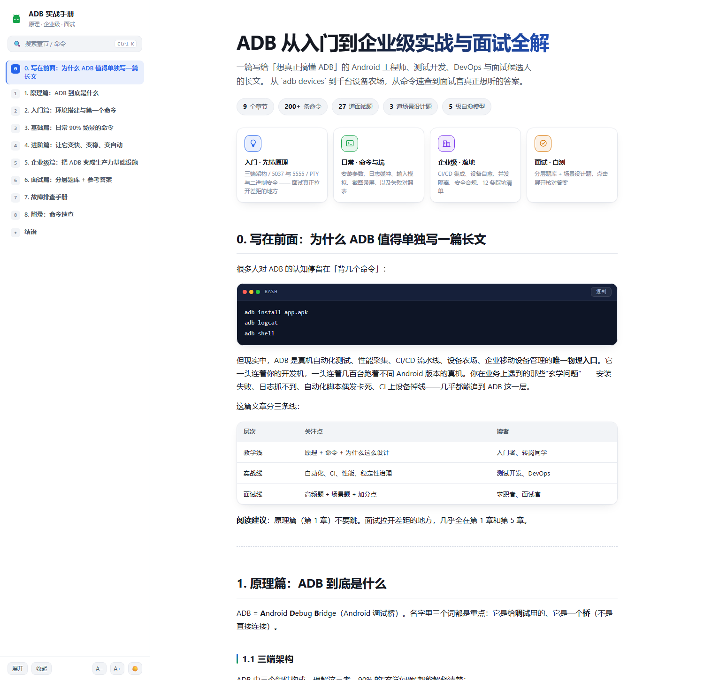
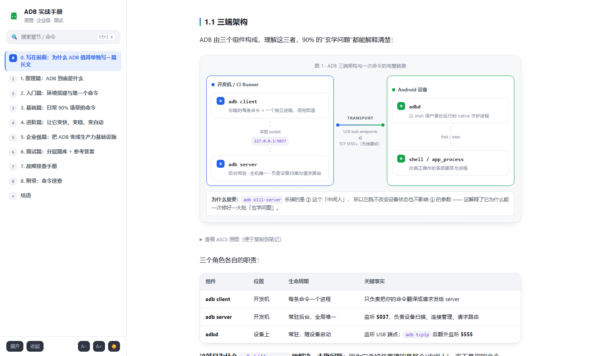
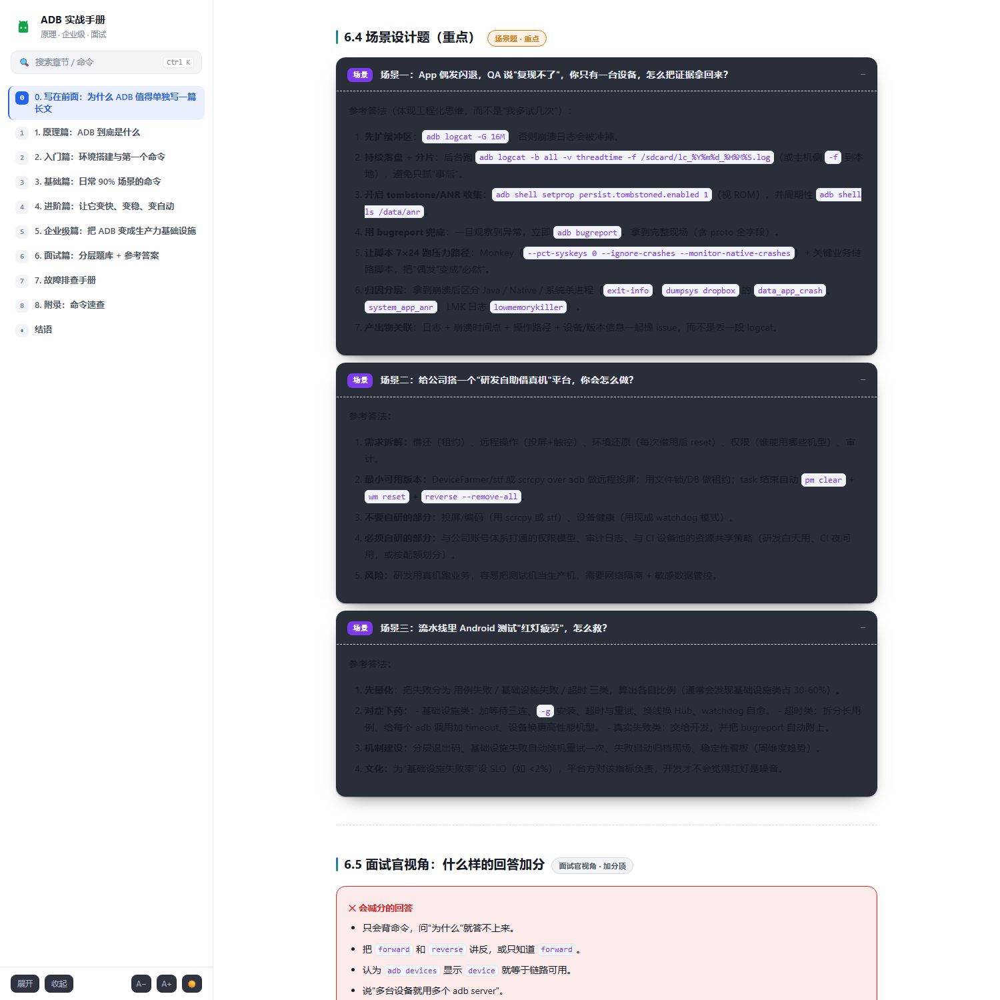
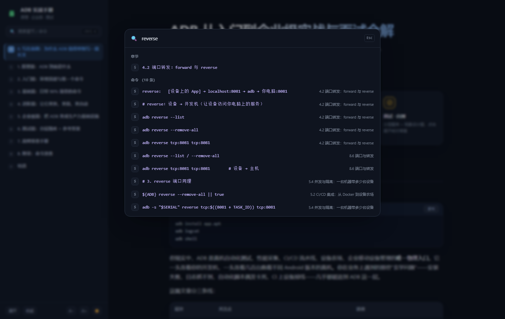
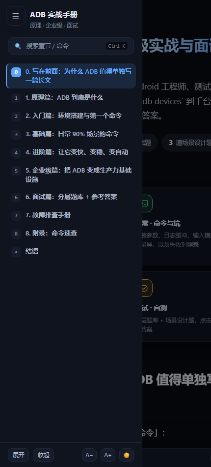

# ADB 从入门到企业级实战与面试全解

> 从 `adb devices` 到千台设备农场的 ADB 一体化手册：**原理 → 命令 → 自动化 → CI/CD → 设备农场 → 安全合规 → 面试题库**。

适合 Android 工程师、测试开发、DevOps，以及正在准备面试的候选人。

---

## 📖 怎么读

| 形式 | 文件 | 说明 |
| --- | --- | --- |
| **交互式网页（推荐）** | [`ADB从入门到企业级实战与面试指南.html`](ADB从入门到企业级实战与面试指南.html) | 单文件、零依赖、可离线打开：带侧边目录、全站命令搜索、面试题折叠自测、明暗主题 |
| Markdown 原文 | [`ADB从入门到企业级实战与面试指南.md`](ADB从入门到企业级实战与面试指南.md) | 便于二次编辑、导入笔记软件 |

网页版直接用浏览器打开即可，**不需要联网、不需要任何 CDN 或字体**。

---

## 📦 里面有什么

| 内容 | 数量 |
| --- | --- |
| 章节 | 9 章 + 结语 |
| 命令 / 代码块 | 49 个代码块，200+ 条命令 |
| 面试题 | 27 道（初级 8 / 中级 10 / 高级 9），每题附参考答案要点 |
| 场景设计题 | 3 道（偶发闪退取证、研发自助借真机平台、流水线红灯疲劳治理） |
| 可视化图 | 2 张（ADB 三端架构、forward/reverse 流向） |
| 对照表 | 17 张（安装失败对照、设备状态、自愈分层、排查手册等） |

**章节结构**

```
0. 写在前面：为什么 ADB 值得单独写一篇长文
1. 原理篇：三端架构 / 端口与协议 / RSA 鉴权
2. 入门篇：环境搭建 / 设备状态全解 / 目标设备指定
3. 基础篇：安装 / 文件传输 / Shell / 组件操作 / logcat / 输入模拟
4. 进阶篇：exec-out 二进制安全 / forward 与 reverse / 无线调试 / 性能诊断
5. 企业级篇：CI-CD 集成 / 设备自愈 / 并发隔离 / 安全合规 / 12 条踩坑清单
6. 面试篇：分层题库 + 场景设计题 + 面试官视角
7. 故障排查手册
8. 附录：命令速查
```

---

## ✨ 网页版的能力

- **全站搜索（`Ctrl/⌘ + K` 或 `/`）**：同时索引 54 个章节与 800+ 行命令，回车跳转并高亮目标代码块
- **面试题折叠自测**：先看题、点开核对答案；带「初级 / 中级 / 高级 / 场景题 / 面试官视角」难度徽章，可一键全部展开或收起
- **代码块体验**：语法着色 + 语言标签 + 一键复制
- **分级提示框**：铁律 / 注意 / 面试视角三档 Callout，减分与加分回答做成红绿双色对照卡
- **阅读体验**：明暗双主题、字号调节、滚动进度条、侧栏章节高亮、标题悬停可复制深链、移动端抽屉目录、打印友好样式

---

## 🖼 截图

总览（浅色主题）



三端架构可视化图



面试题折叠自测（展开态）



全站命令搜索（深色主题）



移动端



---

## 📁 目录结构

```
.
├── ADB从入门到企业级实战与面试指南.md      # 正文源文件
├── ADB从入门到企业级实战与面试指南.html    # 构建产物（交付物，单文件）
├── build/
│   ├── build-blog-html.py                 # Markdown → HTML 全流程构建
│   ├── check-blog-html.py                 # 产物结构自检（标签平衡 / 锚点一致性）
│   ├── check-runtime.py                   # 前端脚本执行自检（无头浏览器）
│   └── shoot.py                           # 关键区域截图走查 / 生成 preview/
└── preview/                               # 预览图
```

---

## 🔧 重新构建

只依赖 Python 3 与 `markdown` 库：

```bash
pip install markdown

# 修改 .md 后重新生成 HTML
python build/build-blog-html.py

# 校验产物
python build/check-blog-html.py
python build/check-runtime.py     # 需要本机装有 Chromium 内核浏览器（Edge / Chrome）

# 重新生成预览图
python build/shoot.py
```

构建脚本会完成：Markdown 转换 → 生成目录与阅读路径卡片 → ASCII 图替换为可视化图 → 面试题转为折叠块 → 引用块分级为 Callout → 表格容器化 → 难度徽章 → 注入搜索 / 主题 / 复制 / 滚动高亮等前端逻辑。

---

## 📝 说明

- 正文为原创整理，欢迎按自己的理解改写与增补。
- `build/` 与 `preview/` 只是配套工具链，删掉不影响 HTML 的独立使用。
